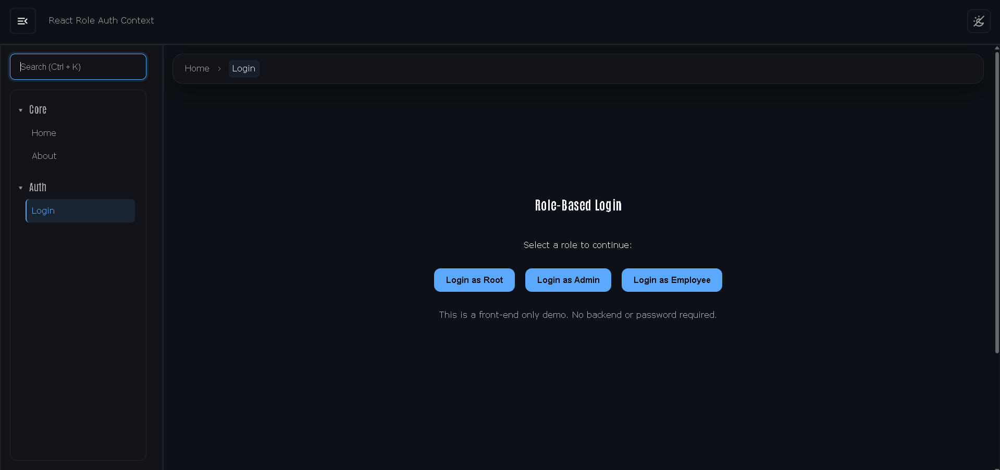

# React Role Auth Context



A front-end only **role-based authentication system** built with **React + Context API + React Router**, featuring
persistent login, role hierarchy, and protected routes - all without a backend.

### 🔗 Links

-   **GitHub Repo:** [https://github.com/a2rp/react-role-auth-context](https://github.com/a2rp/react-role-auth-context)
-   **Live Demo:** [https://a2rp.github.io/react-role-auth-context](https://a2rp.github.io/react-role-auth-context)

---

### 🧠 Overview

This project demonstrates a **clean RBAC (Role-Based Access Control)** structure using only React and localStorage:

| Role     | Accessible Pages                       |
| -------- | -------------------------------------- |
| Root     | Root, Admin, Employee                  |
| Admin    | Admin, Employee                        |
| Employee | Employee                               |
| Guest    | Public pages only (Home, About, Login) |

### ⚙️ Features

-   Role-based route protection (`Root`, `Admin`, `Employee`)
-   Context-based global auth state
-   Persistent login via `localStorage`
-   Public + Private + RoleRoute wrappers
-   Dynamic sidebar navigation by role
-   Unauthorized & 404 fallback pages
-   Light/Dark theme toggle

---

### 🚀 Clone and Run Locally

```bash
# Clone the repository
git clone https://github.com/a2rp/react-role-auth-context.git

# Enter project directory
cd react-role-auth-context

# Install dependencies
npm install

# Start development server
npm run dev
```

## Links

- Portfolio: [https://www.ashishranjan.net](https://www.ashishranjan.net)
- GitHub: [https://github.com/a2rp](https://github.com/a2rp)
- CodePen: [https://codepen.io/ash1198](https://codepen.io/ash1198)
- LinkedIn: [https://www.linkedin.com/in/aashishranjan](https://www.linkedin.com/in/aashishranjan)
- Facebook: [https://www.facebook.com/theash.ashish/](https://www.facebook.com/theash.ashish/)
- YouTube: [https://www.youtube.com/@ashishranjan-ashz?sub_confirmation=1](https://www.youtube.com/@ashishranjan-ashz?sub_confirmation=1)
- Email: [ash.ranjan09@gmail.com](mailto:ash.ranjan09@gmail.com)

## Support

- Support: [https://a2rp-donation-page.netlify.app/](https://a2rp-donation-page.netlify.app/)
- Buy Me A Coffee: [https://buymeacoffee.com/a2rp](https://buymeacoffee.com/a2rp)
- Patreon: [https://patreon.com/a2rp](https://patreon.com/a2rp)
<!-- Project links -->

## Links

- Live: [https://a2rp.github.io/react-role-auth-context/](https://a2rp.github.io/react-role-auth-context/)
- Repository: [https://github.com/a2rp/react-role-auth-context](https://github.com/a2rp/react-role-auth-context)
- Portfolio: [https://www.ashishranjan.net/](https://www.ashishranjan.net/)
- GitHub: [https://github.com/a2rp](https://github.com/a2rp)
- CodePen: [https://codepen.io/ash1198](https://codepen.io/ash1198)
- LinkedIn: [https://www.linkedin.com/in/aashishranjan](https://www.linkedin.com/in/aashishranjan)
- Facebook: [https://www.facebook.com/theash.ashish/](https://www.facebook.com/theash.ashish/)
- YouTube: [https://www.youtube.com/@ashishranjan-ashz?sub_confirmation=1](https://www.youtube.com/@ashishranjan-ashz?sub_confirmation=1)
- Email: [ash.ranjan09@gmail.com](mailto:ash.ranjan09@gmail.com)

## Support

- Support: [https://a2rp-donation-page.netlify.app/](https://a2rp-donation-page.netlify.app/)
- Buy Me a Coffee: [https://buymeacoffee.com/a2rp](https://buymeacoffee.com/a2rp)
- Patreon: [https://www.patreon.com/a2rp](https://www.patreon.com/a2rp)
