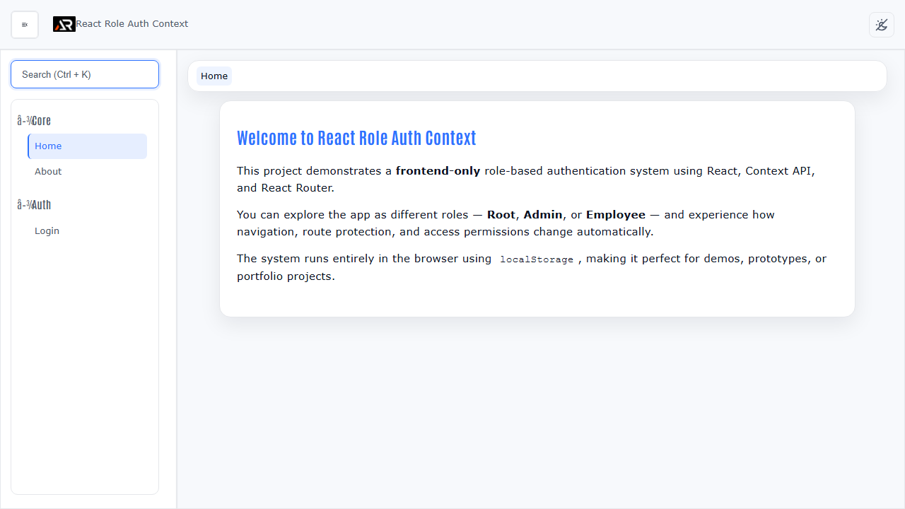

# React Role Auth Context

A frontend React application that demonstrates simulated sign-in, role-aware routes, persistent demo state, and responsive navigation without a backend.

> **Demo limitation:** Sign-in is simulated and stored in browser `localStorage`. Users can change that data, so client-side route guards are not real authentication or a security boundary. Production apps must verify identity and permissions on a trusted server.



## Features

- Public, private, and role-protected routes
- Root, admin, and employee access levels
- Persistent auth state with local storage
- Dynamic navigation based on the signed-in role
- Light and dark themes
- Unauthorized and not-found pages
- Responsive layout with a collapsible sidebar

## Tech stack

React, Vite, React Router, Context API, Material UI, styled-components, and React Icons.

## Run locally

```bash
npm install
npm run dev
```

## Build and deploy

```bash
npm run lint
npm run build
npm run deploy
```

Live demo: [a2rp.github.io/react-role-auth-context](https://a2rp.github.io/react-role-auth-context/)

## Links

- Portfolio: [ashishranjan.net](https://www.ashishranjan.net/)
- GitHub: [github.com/a2rp](https://github.com/a2rp)
- CodePen: [codepen.io/ash1198](https://codepen.io/ash1198)
- LinkedIn: [linkedin.com/in/aashishranjan](https://www.linkedin.com/in/aashishranjan)
- Facebook: [facebook.com/theash.ashish](https://www.facebook.com/theash.ashish/)
- YouTube: [youtube.com/@ashishranjan-ashz](https://www.youtube.com/@ashishranjan-ashz?sub_confirmation=1)
- Email: [ash.ranjan09@gmail.com](mailto:ash.ranjan09@gmail.com)

## Support

- [Support](https://a2rp-donation-page.netlify.app/)
- [Buy Me a Coffee](https://buymeacoffee.com/a2rp)
- [Patreon](https://www.patreon.com/a2rp)
